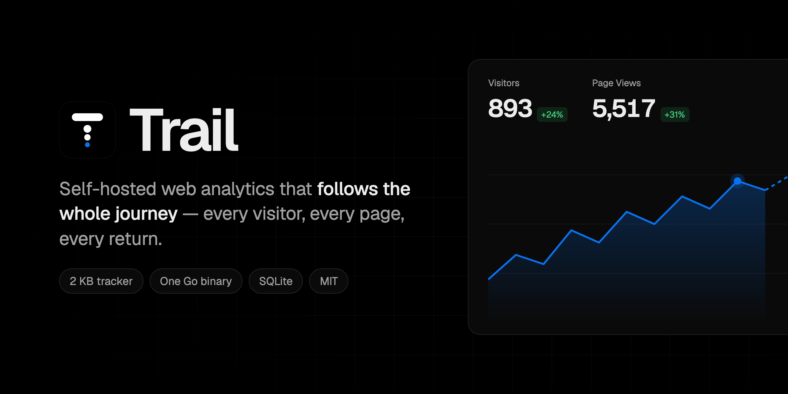
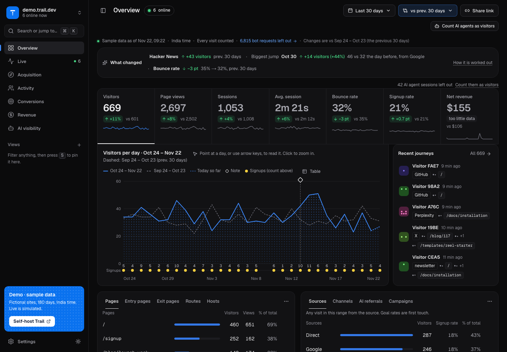
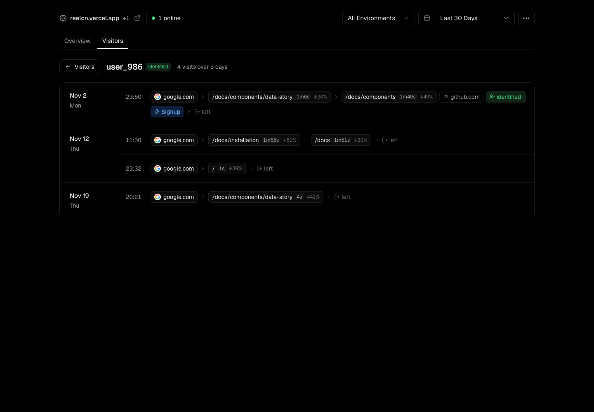

<p align="center">
  
</p>

<p align="center">
  <a href="https://github.com/karanjot786/trail/actions/workflows/ci.yml"></a>
  <a href="LICENSE"></a>
  
</p>

# Trail

Self-hosted web analytics for your own sites: the smallest tracker that still shows the whole visitor journey, private by default until your visitor says yes, on one self-hosted binary. Go, SQLite, an embedded React dashboard, and tracker files under 2 KB gzipped.

**[Docs](https://trail.karanjot.dev/docs/quickstart/)** · [Quickstart](https://trail.karanjot.dev/docs/quickstart/) · [Live demo](https://trail.karanjot.dev/demo)



Follow any visitor across visits and devices — where they came from, every page in order, time on page, and the moment they signed up:



## Features

- Pageviews (including SPA `pushState`, `replaceState` and back/forward), referrers, UTM, country, device, browser, OS
- Custom events, named clicks (`data-trail="Signup"`), `identify` / `reset`, outbound clicks
- Opt-in web vitals, rage clicks, form submits and JS errors (`t.x.js`, loaded only when asked for)
- Per-visitor journey: source, pages in order, time on page, scroll depth, return visits, signup point
- Goals with conversion rates, and a delivery health check
- Three privacy modes; private until consent by default; Do Not Track and GPC honoured
- A read API with bearer tokens and an MCP endpoint for AI assistants
- Honest bounce rate, live "online" count, previous-period comparison
- Multiple sites, one password, no raw IPs stored

## Quick start

Docker:

```sh
docker build -t trail .
docker run -d --name trail -p 8080:8080 -v trail-data:/data \
  -e TRAIL_PASSWORD=change-me \
  -e TRAIL_SITES=mysite=example.com \
  trail
```

Fly.io:

```sh
cp fly.toml.example fly.toml      # set `app`
fly launch --no-deploy --copy-config
fly volumes create trail_data --size 1
fly secrets set TRAIL_PASSWORD=change-me TRAIL_SITES=mysite=example.com
fly deploy
```

Open the host in a browser and log in with `TRAIL_PASSWORD`. Run Trail behind HTTPS (Fly does this for you).

## Configuration

| Variable | Default | Notes |
|---|---|---|
| `TRAIL_PASSWORD` | none, required | Dashboard login password |
| `TRAIL_DB` | `trail.db` (`/data/trail.db` in Docker) | SQLite file path |
| `TRAIL_ADDR` | `:8080` | Listen address |
| `TRAIL_SITES` | empty | Optional `id=domain,id2=domain2`, added at startup if missing. Sites edited in the dashboard keep their edits. You can also add sites in **Settings** |
| `TRAIL_INGEST_RPS` | `50` | Events requests per second per client IP on `/_t/e`, burst twice that. Over the limit is `429`. `0` turns it off |
| `TRAIL_TZ` | `Asia/Kolkata` | Timezone for daily buckets |
| `TRAIL_GEO_DB` | unset | Path to a DB-IP Lite City `.mmdb`. Without it, country is empty |
| `TRAIL_SECRET` | random per start | Signs session cookies (32+ chars). Set it so logins survive restarts |
| `TRAIL_API_TOKENS` | unset | `name:token:scope,...` for the read API and MCP. Scope `read` or `write`; tokens of 24+ chars |
| `TRAIL_DEMO` | unset | `1` serves a read-only demo with generated data at `/demo` |

## Add a site

Open **Settings** in the dashboard and click **Add site**. Paste the domain the site runs on; the site id is suggested from it (it goes in `data-site` and can't be changed later). The site's **Install** panel has copy-ready code for a script tag, npm, Next.js, React and a Vercel rewrite, filled in with the site id and your Trail host. It then polls the server every 3 seconds and shows "Waiting for the first event…" until the first event lands.

Deleting a site stops ingest at once and keeps its data, so adding the same id again brings it back. Tick "also delete data" to remove its events, goals and identities in one go. The same routes are on the API: `GET/POST /api/v1/sites`, `PATCH/DELETE /api/v1/sites/{id}` (`?purge=1` deletes data) and `GET /api/v1/sites/{id}/status`; changes need a `write` token.

## Allowed origins

`/_t/e` accepts events for a site only from a browser page on an allowed host. Trail reads the `Origin` header, or the `Referer` host when there is no `Origin`, and allows:

- the site's domain and any subdomain of it (`example.com`, `www.example.com`; not `evil-example.com`);
- each entry in the site's allowed origins: an exact host like `staging.example.org`, or `*.vercel.app` for every subdomain of `vercel.app` (Vercel preview deployments). Up to 20;
- `localhost`, `127.0.0.1` and `[::1]`, so local development works.

Anything else gets an empty `403`, and the dashboard warns that events were rejected (counted in memory per site, for about the last 24 hours). A request with neither header is refused too; server-side sending will use a per-site secret key in a later release. A `/_t/*` rewrite on your own domain still works: the browser sends your domain as the `Origin`. Edit a site's list in **Settings → ⋯ → Allowed origins**.

## Adding Trail to a site

Proxy the tracker through your own domain so it is first-party and not blocked.

Vercel (`vercel.json`):

```json
{"rewrites":[{"source":"/_t/:p*","destination":"https://<trail-host>/_t/:p*"}]}
```

Next.js (`next.config.js`):

```js
module.exports = {
  async rewrites() {
    return [{ source: '/_t/:p*', destination: 'https://<trail-host>/_t/:p*' }];
  },
};
```

Then add the script:

```html
<script defer src="/_t/t.js" data-site="mysite"></script>
```

`data-site` must match a site id from **Settings** (or `TRAIL_SITES`). The tracker does nothing on `localhost` unless `data-dev` is set.

### With npm

```sh
npm i trail-analytics
```

```tsx
// app/layout.tsx (Next.js App Router)
import { Analytics } from 'trail-analytics/next';
// ...
<Analytics site="mysite" />
```

It injects the script, computes route patterns like `/blog/[slug]`, and exports typed `track`, `identify`, `reset`, `pageview`. See [packages/trail-analytics](packages/trail-analytics). The `/_t/*` rewrite above is still required.

### Tracker API

```js
trail.track('signup_clicked', { plan: 'pro' }); // custom event, flat props (max 20 keys)
trail.identify(user.id);                         // call on login
trail.reset();                                   // call on logout
trail.pageview({ route: '/blog/[slug]' });       // manual pageview, optional route template
trail.consent(true);                             // visitor said yes: upgrade to full mode
trail.consent(false);                            // visitor said no: wipe ids, stop sending
```

Calls made before the script loads are queued if you define `window.trail` as a function and collect arguments in `window.trailq`.

`identify` with a different user on the same device rotates the anonymous id first, so users are never merged by accident.

Script attributes:

| Attribute | Purpose |
|---|---|
| `data-site` | Site id (required) |
| `data-api` | Ingest endpoint, default `/_t/e` |
| `data-env` | Tag events, e.g. `production` or `preview`; the dashboard can filter on it |
| `data-dev` | Also track on `localhost` |
| `data-route` | Default route template for pageviews |
| `data-mode` | `full` stores an id from the first page; `private` never stores anything. Absent: private until consent |
| `data-dnt` | `off` tracks visitors who send Do Not Track or Global Privacy Control (they are skipped by default) |
| `data-vitals` | Opt in to web vitals |
| `data-rage` | Opt in to rage-click detection |
| `data-forms` | Opt in to form-submit events; records the form id or name, never field values. Loaded via `t.x.js` |
| `data-errors` | Opt in to JS error events, at most 5 per page. Loaded via `t.x.js` |

Any element with `data-trail="Name"` records a named click event (full mode). `/_t/t.p.js` is a smaller private-only build.

## What is tracked

- **Pageviews**, with referrer, UTM and country/device/browser/OS derived server-side from the request
- **Engagement**: visible time on page and scroll depth
- **Events**: custom events, named clicks, identify, outbound link clicks; form submits and JS errors (max 5 per page) when opted in
- Bots are stored with a flag and excluded from every dashboard number.

Definitions:

- **Session**: ends after 30 minutes of inactivity, 24-hour hard cap. A new external referrer or new UTM starts a new session. Sessions do not split at midnight.
- **Visitors**: distinct people with at least one non-bot event in the range. A person is the user id from `identify` if there is one, otherwise the anonymous id. Visitors are not reset daily.
- **Engaged session**: 10 s or more of visible time, or 2+ pageviews, or any custom event or identify.
- **Bounce rate**: `1 - engaged sessions / sessions`.
- **Online**: distinct anonymous ids with any event in the last 5 minutes.

## Geo (optional)

Trail reads country from a DB-IP Lite City database. Download `dbip-city-lite-YYYY-MM.mmdb` manually from <https://db-ip.com/db/lite.php>, put it on the server (for example in `/data`) and set `TRAIL_GEO_DB`. Refresh it monthly if you want current data.

The DB-IP Lite database is licensed CC-BY 4.0. You must attribute it, for example: "IP geolocation by DB-IP.com".

## Backups

The database is a single SQLite file. Take consistent snapshots with a cron job on the host:

```sh
0 3 * * * sqlite3 /data/trail.db ".backup /backups/trail-$(date +\%F).db"
```

(`%` must be escaped as `\%` inside crontab.) On Fly, use `fly ssh console` or volume snapshots.

## Privacy modes

| Mode | Set with | Browser storage | Journeys |
|---|---|---|---|
| Private until consent (default) | no `data-mode` | none until `trail.consent(true)` or `identify()` | from consent onwards |
| Private | `data-mode="private"` or `/_t/t.p.js` | none, ever | within one day |
| Full | `data-mode="full"` | first-party `_t_id` cookie and localStorage | across visits and devices |

- Private visitors are counted on the server as `HMAC-SHA256(daily key, site|IP|UA)`. The key is random, held only in memory and replaced at midnight in `TRAIL_TZ`.
- `trail.consent(false)` deletes `_t_id`, `_t_s`, `_t_u` and the queue, stops sending, and remembers the choice in `localStorage._t_c`.
- Do Not Track and Global Privacy Control mean nothing is sent, unless the tag has `data-dnt="off"`.
- The raw IP address is never written to disk. It is used in memory for geo, bot checks and the private-mode hash only. No third parties are involved.

## Tracker cost

Measured, not promised. Sizes are gzip level 9; timings are the median of 15 runs of `tracker/bench/bench.mjs` in headless Chromium, as the difference from the same page without a tracker (2026-11-20).

| File | Gzipped | Script at load | Heap added | Requests per pageview |
|---|---|---|---|---|
| `t.p.js`, private only | 1,490 B | 1.33 ms | 117 KB | 2 |
| `t.js`, all modes, default private until consent | 2,040 B | 1.61 ms | 120 KB | 2 |
| `t.js` with `data-mode="full"` | same file | 2.15 ms | 126 KB | 2 |
| `t.x.js`, extras loaded on demand | 740 B | — | — | — |

Every tracker file must stay at or under 2,048 B gzipped; CI fails otherwise. Rerun with `cd tracker && npm run bench`. Method: [Tracker cost](https://trail.karanjot.dev/docs/tracking/cost/).

## API and MCP

Give scripts and AI assistants read access with a token:

```sh
TRAIL_API_TOKENS="laptop:$(openssl rand -hex 24):read"
```

Read API: the dashboard's reports under `/api/v1/` with `Authorization: Bearer <token>`.

```sh
curl -H "Authorization: Bearer $TOKEN" "https://stats.example.com/api/v1/stats?site=mysite&env=all"
# {"visitors":1,"pageviews":1,"bounce":1,"prev":{"visitors":0,"pageviews":0,"bounce":0},"online":1}
```

Routes: `sites`, `stats`, `series`, `breakdown`, `visitors`, `journey`, `goals`, `goals/report`, `delivery`. Creating or deleting goals and sites needs a `write` token. 300 requests per minute per token.

MCP: `POST /mcp` speaks the Model Context Protocol over streamable HTTP, with tools `list_sites`, `get_stats`, `get_series`, `get_breakdown`, `list_visitors`, `get_journey` and `goal_report`.

```sh
claude mcp add --transport http trail https://stats.example.com/mcp \
  --header "Authorization: Bearer <read-token>"
```

Details: [Read API](https://trail.karanjot.dev/docs/api/read-api/), [MCP](https://trail.karanjot.dev/docs/api/mcp/).

## Development

Requirements: Go 1.26+, Node 22+, pnpm.

```sh
make build      # tracker, then dashboard, then ./trail (static, CGO_ENABLED=0)
make test       # go test, tracker (Playwright) and dashboard (Vitest) tests
make seed       # fill dev.db with fake data (2 sites, ~30 days)
make dev        # run the server on :8080 with dev.db; `cd web && pnpm dev` for the UI
make clean
```

The tracker is built from `tracker/t.ts` and `tracker/x.ts` into `internal/ingest/t.js`, `t.p.js` and `t.x.js`, all embedded in the binary; the dashboard is built into `web/dist` and embedded too. The landing page and docs live in `site/` (`cd site && pnpm install && pnpm dev`).

## Contributing

Issues and PRs welcome — see [CONTRIBUTING.md](CONTRIBUTING.md) and the [Code of Conduct](CODE_OF_CONDUCT.md). Security issues: [SECURITY.md](SECURITY.md).

## License

MIT © [Karanjot Singh](https://github.com/karanjot786). See [LICENSE](LICENSE).
