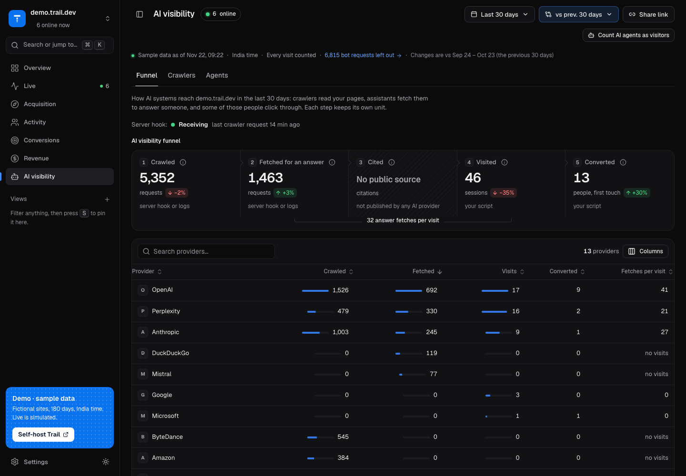

# AI visibility



**AI visibility** in the sidebar shows how AI systems reach your site. It has three tabs: **Funnel** (the default), **Crawlers** and **Agents**. The URL is `/ai`, and the old `/crawlers` link redirects to `/ai/crawlers`. Pick one website first: the screen does not work across all sites at once.

AI systems reach a site in two different ways, and Trail counts them from two different sources:

| | Crawlers | Agents |
|---|---|---|
| What they are | Bots that fetch your pages to index them, train on them or answer a question | AI browsing agents that open your pages in a real browser and act for a person |
| Run your script | Never | Yes |
| How Trail sees them | A server hook or your access logs. See [AI crawlers](/add/ai-crawlers) | The requests your script already sends. Nothing to set up |
| Tab | **Crawlers** | **Agents** |

## Funnel

The funnel follows AI traffic through five steps. Each step keeps its own unit, so the screen never shows a percentage from one step to the next. Between the steps it shows a ratio instead, such as "37 answer fetches per visit". When nothing has been referred yet it reads "no visits yet".

| Step | Unit | Source | What it counts |
|---|---|---|---|
| Crawled | requests | server hook or logs | Requests from AI crawlers that index pages or collect them for training |
| Fetched for an answer | requests | server hook or logs | Requests from assistants that fetched a page live because a person asked them something |
| Cited | citations | not published by any AI provider | Nothing: see below |
| Visited | sessions | your script | Visits that arrived from an AI assistant |
| Converted | people, first touch | your script | People whose first visit came from an AI assistant and who later reached the goal |

Notes on the steps:

- **Cited** shows **No public source** and no number. No AI provider publishes which answers cite your pages, so Trail does not guess. No ratio is computed through this step.
- **Crawled** and **Fetched for an answer** show **Not set up** until crawler requests reach Trail. The **Unlock AI crawlers** card above the funnel sets that up in one command. Once requests arrive, a status line replaces the card.
- **Converted** shows **Set up a goal** when the site has no goal. See [Goals](/dashboard/conversions).
- **Visited** and **Converted** use the same counting as the AI referrals report, so the numbers agree across screens.
- Crawler data is daily, so a single-day range (today, yesterday or one date) is widened to the last 7 days for every step.

Below the funnel, a providers table lists crawled, fetched, visits, converted and fetches per visit for each AI provider, and **Pages AI systems requested** lists pages by path. The **Method** note at the bottom repeats the definitions. When some crawlers publish their IP addresses, it also says what share of their requests came from those listed addresses.

## Unlock AI crawlers

AI crawlers never run your script. The card explains that and offers **Create token and copy command**. The button creates a site-bound crawl token, puts it into the command and copies it:

```sh
npx trail-analytics@latest init --url https://trail.example.com --site mysite --token <token>
```

The token is shown once. It can only add crawler requests to that one site, and you can revoke it in **Settings → API tokens**. In the public demo and share links the button is disabled and the command shows `<token>`.

The status row under the button reads **Receiving**, **Not receiving yet** or **Nothing in the last 24 hours**. While nothing has arrived it checks again every 10 seconds. Crawlers visit irregularly, so the first request can take hours. **Other ways (server logs, any proxy)** holds the log import options. See [AI crawlers](/add/ai-crawlers) for what the command writes.

## Crawlers

The Crawlers tab lists requests from known AI crawlers by what they do, and which pages they requested. Crawlers never count as visitors.

Crawlers are recognised by user agent. For crawlers whose operators publish IP lists, the method note says what share of their requests came from the listed addresses. A crawler that fakes its user agent is still counted as the crawler it claims to be. Requests reported by a Next.js proxy have no status code, because the proxy runs before the page, and show as "n/a".

## Agents

AI browsing agents load your pages in a browser and run your script, so Trail sees them in the requests the script already sends. You do not need to set anything up. Trail recognises these agents:

| Agent | Operator |
|---|---|
| Claude agent | Anthropic |
| Google-Agent | Google |
| ChatGPT agent | OpenAI |

The tab shows agent sessions, pages viewed, the verified share and goal completions, a chart of verified and claimed sessions, a card per agent, **Latest agent sessions** and **Pages agents viewed**. Click a row in **Latest agent sessions** to open that journey.

### Verified and claimed

Trail checks each request in this order and keeps the first answer:

1. **Signed request (Web Bot Auth).** The request carries a valid signature from the agent operator's published keys.
2. **Signed request seen by your server hook.** Your server hook saw a verified signed page request from the same browser (same site, IP and user agent) in the last 30 minutes and passed it to Trail.
3. **IP in the operator's published list.** The client IP is in the agent operator's published IP list.
4. **User agent only.** The user agent names the agent, but nothing else confirms it.

The first three are shown as **Verified**. The last is shown as **Claimed**, because anyone can send any user agent. The lists and keys are fetched in the background; see [AI agent lists](/operations/configuration#ai-agent-lists). The method note says when they were last updated, or "Lists unavailable: agents are identified by user agent only".

ChatGPT agent signs only page requests, not the requests your script sends. Run `npx trail-analytics init` so your server can pass the signature to Trail. Without it, ChatGPT agent looks like a person.

### The journey badge

A journey from an agent session shows **AI agent**, the agent's name and a **Verified** or **Claimed** badge next to the session. Hover or focus the badge to see how the agent was recognised: "Signed request (Web Bot Auth)", "Signed request seen by your server hook", "IP in Google's published list" (with the operator's name), or "User agent only; not verified".

## Count AI agents as visitors

Agents are not people, so by default they are left out of every visitor number: visitors, bounce rate, conversion rate and the rest. Agent events are kept and shown on the Agents tab.

When a site has agent sessions in the selected range, the filter bar shows a **Count AI agents as visitors** toggle. Turning it on adds `actor=all` to the URL, and every report counts agents too. Back undoes it, and **Clear all** keeps it, because it is a scope rather than a filter.

The Overview says what is happening under the KPI strip: "12 AI agent sessions left out" with **Count them as visitors**, or "Includes 12 AI agent sessions" with **Leave them out**.

## What cannot be detected

- **Agents that run inside a person's own browser**, such as AI browser assistants and extensions, use that person's browser, address and user agent. They look like that person and are not detected.
- **Crawlers on a site with no server hook and no log import.** They never run the script, so the crawler steps stay **Not set up**.
- **Citations.** No AI provider publishes them, so **Cited** has no number.

## Next

- Capture crawlers with [AI crawlers](/add/ai-crawlers).
- Turn off the list downloads with [`TRAIL_AGENT_LISTS`](/operations/configuration#ai-agent-lists).
- Read the rest of the dashboard in [Overview](/dashboard/overview).
