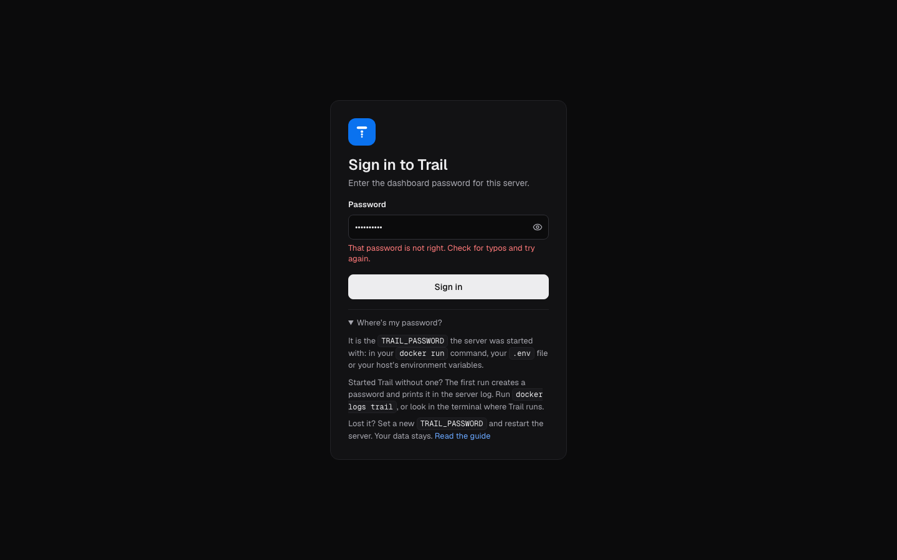
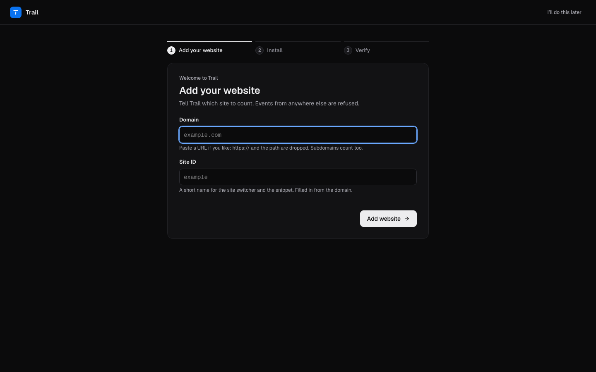
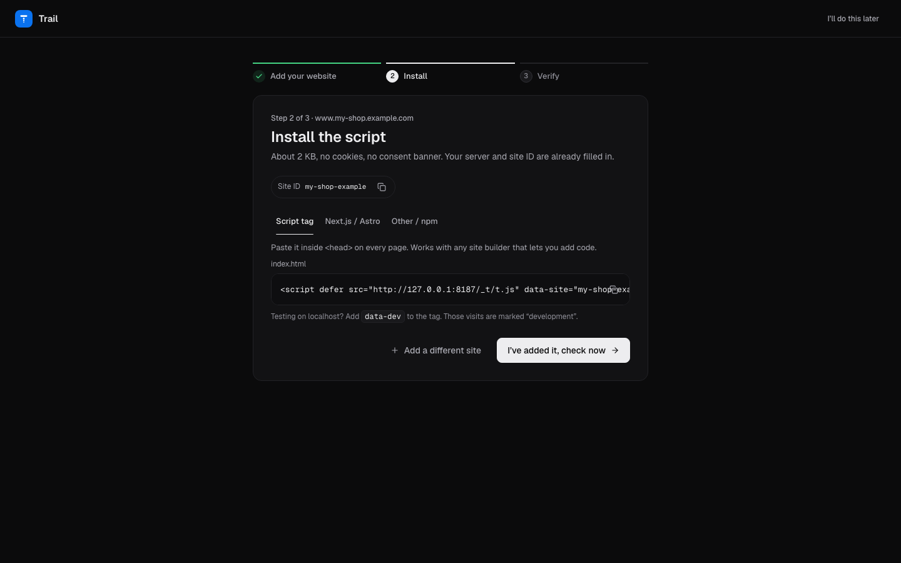
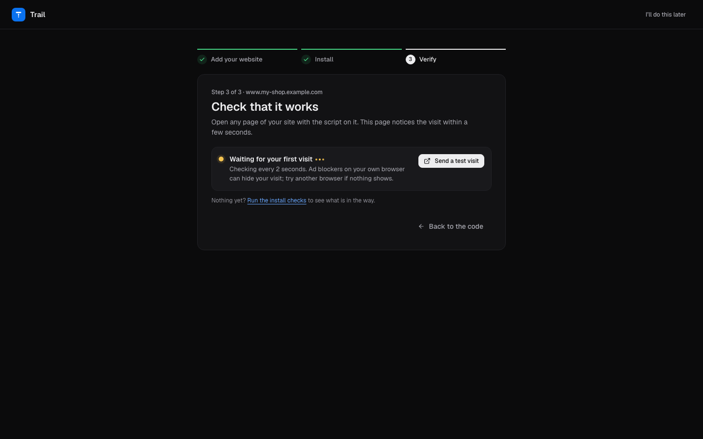
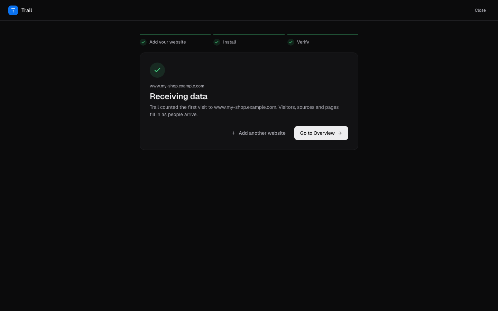

# First run in the dashboard

The first time you open Trail, the dashboard walks you through setup: sign in, add your website, install the script, then check that the first visit arrives. It takes a few minutes, and you can stop at any step and pick up later.

## Sign in

Open your Trail server's address, for example `http://localhost:8080` or `https://trail.example.com`, and enter the dashboard password.

- The eye button shows the password, so you can check it for typos.
- A wrong password says so. If the dashboard can't reach the server, it says that instead, so you know to check that Trail is running.
- You stay signed in for 30 days on that browser.

### Where is my password?

It is the `TRAIL_PASSWORD` value the server was started with. Look in:

- your `docker run` command or `docker-compose.yml`,
- your `.env` file or systemd unit,
- your host's environment variables (Fly.io secrets, Railway variables and so on).

If you started Trail without `TRAIL_PASSWORD`, the first run creates a password and prints it in the server log. Run `docker logs trail`, or look in the terminal where Trail runs.

Lost it? Set a new `TRAIL_PASSWORD` and restart the server. Your data stays, and everyone signed in is signed out.

## 1. Add your website

If the server has no sites yet, you land here right after signing in.

- **Domain**: type `example.com` or paste a full URL. `https://`, the port and the path are removed for you, so `https://www.example.com/pricing` is saved as `www.example.com`. Subdomains always count, so `*.example.com` is saved as `example.com`.
- **Site ID**: filled in from the domain (`www.example.com` becomes `example`). It goes in the snippet as `data-site`. Use lowercase letters, digits and dashes.

Events from any other domain are refused. To accept more hosts later, add them as [allowed origins](/operations/configuration#allowed-origins).

## 2. Install the script

Pick how your site is built. Your server address and site ID are already in the code, and each block has a copy button.

- **Script tag**: paste one line inside `<head>` on every page. Works with any site builder that lets you add code.
- **Next.js / Astro**: click **Create token and fill it in**. You get one `npx trail-analytics init` command with a crawl token in it. Run it in your project folder: it adds the script to your root layout and also counts AI crawlers. See [AI crawlers](/add/ai-crawlers).
- **Other / npm**: `npm i trail-analytics`, then call `inject()` once when your app starts. React, Vue, SvelteKit, WordPress and Hugo snippets are in **Settings → Install**.

Testing on `localhost`? Add `data-dev` to the tag. Those visits are tagged `development`, so pick **All environments** in the header to see them in charts.

## 3. Check that it works

Open any page of your site. The dashboard checks every 2 seconds and moves on by itself as soon as the first event arrives.

- **Send a test visit** opens your site in a new tab.
- If nothing arrives after 30 seconds, the [install checks](/operations/troubleshooting) open: the checks run from your server against your live site, each with a reason code and the fix. Warnings and **Blocked** are explained in [the install check](/operations/troubleshooting#the-install-check).
- An ad blocker in your own browser can hide your visit. Try another browser before you change anything.

## Done

**Go to Overview** opens the dashboard for your site. Visitors, sources and pages fill in as people arrive. See [Overview](/dashboard/overview).

## Skip and come back later

Click **I'll do this later** at the top right on any step. The dashboard remembers that choice for the site in this browser and shows its empty Overview instead.

Each step has its own address, like `/welcome/install?site=example`, so a reload or a bookmark resumes where you left off.

The walkthrough comes back by itself for a site that has never received an event, unless you skipped it. That includes sites you set up with [`TRAIL_SITES`](/operations/configuration): they start at step 2.

## Add more websites

Open the site switcher at the top of the sidebar and choose **Add a website**. You get the same three steps. **Cancel** takes you back to the site you were on.

The [public demo](https://trail.karanjot.co.in/demo) never shows this walkthrough.
