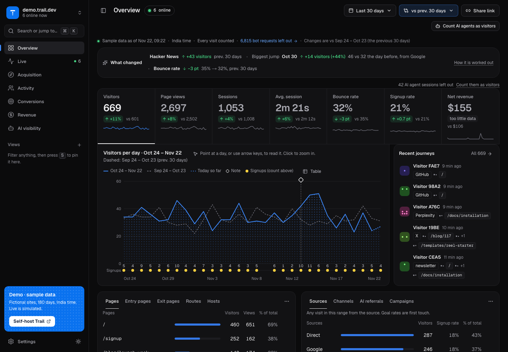

# Overview

## The header

- **Site**: switch between your sites. The arrow opens the site itself. Add and remove sites in [Settings](#settings).
- **Online**: distinct visitors with any event in the last 5 minutes, in every environment.
- **Environment**: Production, Preview or All Environments. See [Environments](/operations/configuration#environments).
- **Range**: the last 24 hours, 7 or 30 days, 3 or 12 months, or a custom range.
- **Menu** (`...`): refresh, visitors, [delivery health](/dashboard/delivery) and copy link.

Under the header, the tabs are **Overview**, **Visitors** and **Settings**.

## The numbers

| Number | Definition |
|---|---|
| Visitors | Distinct people with at least one non-bot event in the range. A person is the id from `identify` if there is one, otherwise the anonymous id. Not reset daily |
| Page Views | Pageview events in the range, including single-page-app navigations |
| Bounce Rate | `1 - engaged sessions / sessions`. A session is engaged after 10 s of visible time, 2 or more pageviews, or any custom event or identify |

Each shows the change against the previous range of the same length. Click one to chart it.

A **session** ends after 30 minutes without activity, and lasts at most 24 hours. A new outside referrer or new UTM tags start a new session. Sessions do not split at midnight.

## The panels

Pages, routes and hostnames; referrers and UTM parameters; countries; devices and browsers; operating systems; custom events; and [goals](/dashboard/goals). Click any row to filter the whole dashboard by it. Filters show as chips under the header; remove one to widen the view again.

Source filters (referrer and UTM) keep whole sessions that arrived from that source, so the pages those visitors went on to read stay in view.

## Settings

The **Settings** tab lists every site Trail accepts events for. Each card shows the domain, the site id, how many events arrived in the last 24 hours, when the last one came, and which hosts may send. On a fresh install there are no sites yet, and Settings is the whole screen until you add one.

**Add a site.** Click **Add site** and paste the domain, as a URL or a bare host such as `example.com`. Trail suggests an id from it. The id goes in `data-site` and cannot be changed later: 1 to 40 characters, lowercase letters, digits and dashes. The domain and all its subdomains are allowed at once.

**Install and live check.** The **Install** button on a card opens copy-ready code with your site id and your Trail host filled in: a script tag, npm, Next.js, React and a Vercel rewrite. Under the tabs, a live check asks the server every 3 seconds. It reads "Waiting for the first event…" until one lands, then "Receiving data" with the age of the last event. If events came from a host that is not on the site's list, a warning counts them and links to **Allowed origins**. That count lives in memory, covers about the last 24 hours, and resets when the server restarts.

**The `...` menu** on each card has two items:

- **Allowed origins**: extra hosts that may send events for the site, one per line, up to 20. Use `*.vercel.app` to cover every preview deployment. The site's own domain and subdomains, and `localhost`, are always allowed. See [Allowed origins](/operations/configuration#allowed-origins).
- **Delete site**: type the site id to confirm. Trail stops accepting its events at once and keeps its data, so adding the same id again brings it back. Tick **Also delete its data** to remove every event, goal and identity for the site. That cannot be undone.

Sites listed in `TRAIL_SITES` are added at startup if they are missing. Edits made in Settings are kept across restarts. Everything here is also on the [API](/api/read-api#sites).
