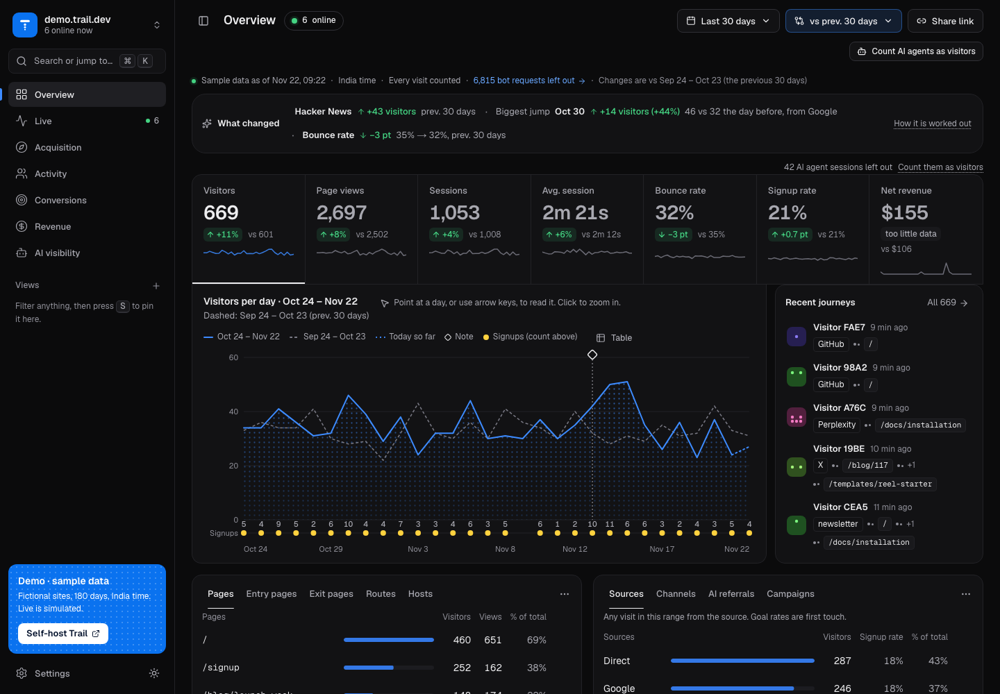

## The header

- **Site**: switch between the sites in `TRAIL_SITES`. The arrow opens the site itself.
- **Online**: distinct visitors with any event in the last 5 minutes, in every environment.
- **Environment**: Production, Preview or All Environments. See [Environments](/docs/operations/configuration/#environments).
- **Range**: the last 24 hours, 7 or 30 days, 3 or 12 months, or a custom range.
- **Menu** (`...`): refresh, visitors, and [delivery health](/docs/dashboard/delivery/).

## The numbers

| Number | Definition |
|---|---|
| Visitors | Distinct people with at least one non-bot event in the range. A person is the id from `identify` if there is one, otherwise the anonymous id. Not reset daily |
| Page Views | Pageview events in the range, including single-page-app navigations |
| Bounce Rate | `1 - engaged sessions / sessions`. A session is engaged after 10 s of visible time, 2 or more pageviews, or any custom event or identify |

Each shows the change against the previous range of the same length. Click one to chart it.

A **session** ends after 30 minutes without activity, and lasts at most 24 hours. A new outside referrer or new UTM tags start a new session. Sessions do not split at midnight.

## The panels

Pages, routes and hostnames; referrers and UTM parameters; countries; devices and browsers; operating systems; custom events; and [goals](/docs/dashboard/goals/). Click any row to filter the whole dashboard by it. Filters show as chips under the header; remove one to widen the view again.

Source filters (referrer and UTM) keep whole sessions that arrived from that source, so the pages those visitors went on to read stay in view.
