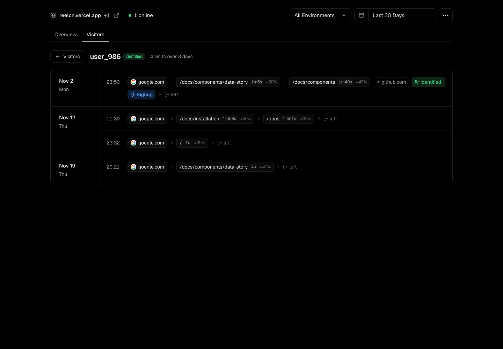

The **Visitors** tab lists the people seen in the range: person, location, first source, number of visits, and first and last seen. Search by person id at the top.

Click a person to open their journey.

Each visit is one row, grouped by day, read left to right:

- **Source**: the referrer or campaign that started the visit.
- **Pages**, in order, each with time on page and how far down the visitor scrolled.
- **Events**: custom events, named clicks, outbound links and form submits.
- **identified**: the moment `trail.identify()` linked this anonymous visitor to your user id.
- **left**: the end of the visit.

## How visits join up

- In **full mode** the tracker keeps a random id in a first-party cookie and localStorage, so visits from the same browser join one journey across days.
- Call `trail.identify(userId)` when someone signs in. Their earlier anonymous visits on that device join the same person, and visits from any other device where they sign in join too.
- Calling `identify` with a different user on the same device starts a fresh anonymous id first, so two people sharing a laptop are never merged.
- In **private mode** nothing is stored in the browser. The server groups a visitor's pageviews within one day, so a journey covers a single day at most.

See [Privacy modes](/docs/tracking/privacy/) for how to choose.
